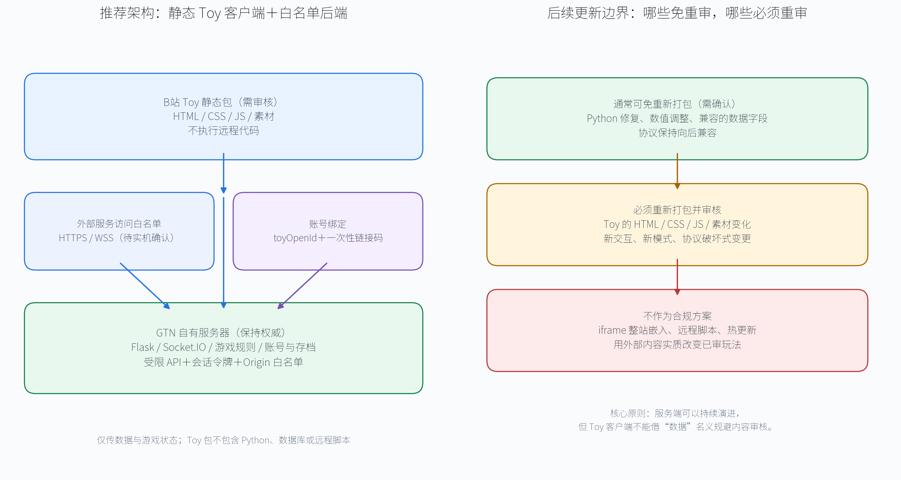

# GTN 接入哔哩哔哩 Toy：技术决策与验证方案

> 调研日期：2026-10-30  
> 范围：仅技术调研、架构分析与实验设计；未修改正式代码、未部署、未执行 Toy 实机实验。

## 1. 决策摘要

**“只制作并发布一次，之后 Python、HTML、CSS、JavaScript、卡牌、模式与交互全部自动同步”不能作为合规目标。** Toy 的官方使用协议明确禁止通过远程脚本、iframe、动态加载或热更新来规避审核、实质改变已审核内容；平台实际的发布模型也是静态包提交与审核，而不是让创作者站点长期替代 Toy 页面。[Toy 使用协议](kimi-cite://web?url=https%3A%2F%2Fs1.hdslb.com%2Fbfs%2Fstatic%2Ftoy%2Fapp%2Fpublish%2Fassets%2Findex-CR0Z-UJA.js&text=%E6%82%A8%E4%B8%8D%E5%BE%97%E9%80%9A%E8%BF%87%E8%BF%9C%E7%A8%8B%E8%84%9A%E6%9C%AC%E3%80%81iframe%E3%80%81%E8%B7%B3%E8%BD%AC%E3%80%81%E5%A4%96%E9%93%BE%E8%B5%84%E6%BA%90%E3%80%81%E5%8A%A8%E6%80%81%E5%8A%A0%E8%BD%BD%E3%80%81%E7%83%AD%E6%9B%B4%E6%96%B0%E7%AD%89%E6%96%B9%E5%BC%8F%E8%A7%84%E9%81%BF%E5%B9%B3%E5%8F%B0%E6%96%B9%E5%AE%A1%E6%A0%B8%E3%80%81%E5%AE%9E%E8%B4%A8%E5%8F%98%E6%9B%B4%E5%B7%B2%E5%AE%A1%E6%A0%B8%E5%86%85%E5%AE%B9%E3%80%82 "citation")

**推荐路线是“静态 Toy 客户端＋经外部服务白名单访问的 GTN 后端＋版本化数据协议”。** Python 引擎、账号、存档、多人房间和权威规则继续由现有服务器承担；Toy 只包含经过审核的静态客户端。后续更新分为两类：服务端兼容更新不改变 Toy 包，客户端代码、素材、交互或协议发生破坏式变化时重新打包并审核。所谓“只发布一次”只能在**玩法边界、客户端表现和协议均固定**时近似成立，不能承诺新增模式也免审。[Toy 发布工作流](kimi-cite://web?url=https%3A%2F%2Fraw.githubusercontent.com%2Fbilibili%2Ftoy%2Fmain%2Fskills%2Ftoy%2FSKILL.md "citation")

## 2. 结论与证据等级

| 结论 | 等级 | 判断依据 |
|---|---|---|
| Toy 上传的是静态网页项目，发布和更新都有审核流程 | **已确认** | 官方 CLI 将 `create/update` 分为预览与提交审核，纯改元信息也会进入审核；不是上传后立即无审核上线。[Toy CLI 工作流](kimi-cite://web?url=https%3A%2F%2Fraw.githubusercontent.com%2Fbilibili%2Ftoy%2Fmain%2Fskills%2Ftoy%2FSKILL.md "citation") |
| 整站 iframe、远程脚本或热更新不能作为合规方案 | **已确认** | 使用协议第 2.7 条直接覆盖这些方式及其“实质变更已审核内容”的目的。 |
| GTN 自有 Flask／Socket.IO 后端可以保留 | **已确认能力，仍需实机验证** | 发布平台存在 `external_service_access` 能力，说明可连接创作者服务器、外部 AI、第三方接口及站外资源，并要求配置域名。[外部服务访问说明](kimi-cite://web?url=https%3A%2F%2Fs1.hdslb.com%2Fbfs%2Fstatic%2Ftoy%2Fapp%2Fpublish%2Fassets%2Findex-CR0Z-UJA.js&text=%E8%BF%9E%E6%8E%A5%E5%88%9B%E4%BD%9C%E8%80%85%E6%9C%8D%E5%8A%A1%E5%99%A8%E3%80%81%E5%A4%96%E9%83%A8%20AI%E3%80%81%E7%AC%AC%E4%B8%89%E6%96%B9%E6%8E%A5%E5%8F%A3%E6%88%96%E5%8A%A0%E8%BD%BD%E7%AB%99%E5%A4%96%E5%9B%BE%E7%89%87%E3%80%81%E9%9F%B3%E8%A7%86%E9%A2%91%E3%80%81%E5%AD%97%E4%BD%93%E7%AD%89%E8%B5%84%E6%BA%90 "citation") |
| HTTPS API、WebSocket、Socket.IO 能否在 Toy 内稳定使用 | **未验证** | 外部服务权限存在，但公开 SDK 文档没有给出通用房间或 Socket.IO 能力承诺，必须分别验证握手、Origin、CORS 和 App 行为。 |
| Toy 与网页可共用账号与存档 | **代码上可设计，尚未验证** | GTN 后端与数据库可复用，但 Toy 的 `toyOpenId` 只是当前 Toy 内假名标识，不是鉴权凭证，必须增加账号绑定和会话适配。[Toy 用户资料说明](kimi-cite://web?url=https%3A%2F%2Fs1.hdslb.com%2Fbfs%2Fstatic%2Ftoy%2Fapp%2Fpublish%2Fassets%2Findex-CR0Z-UJA.js&text=%E5%BD%93%E5%89%8D%E7%99%BB%E5%BD%95%E7%94%A8%E6%88%B7%E5%9C%A8%E5%BD%93%E5%89%8D%20Toy%20%E5%86%85%E7%9A%84%E7%A8%B3%E5%AE%9A%E5%81%87%E5%90%8D%E6%A0%87%E8%AF%86%EF%BC%8C%E4%B8%8D%E6%98%AF%E9%89%B4%E6%9D%83%E5%87%AD%E8%AF%81 "citation") |
| 新增模式也能永久免审 | **不可承诺** | 新交互、新素材和新玩法通常改变客户端或已审内容；没有证据支持“新增模式免审”。 |
| 服务端数值与数据更新可尽量少动 Toy 包 | **架构推断，审核边界需书面确认** | 数据可以经外部服务提供，但“数据更新到哪一步仍属原审核范围”需要平台确认，不能用数据名义掩盖玩法变更。 |

## 3. Toy 平台的真实能力与限制

### 3.1 静态包、路径与缓存

Toy 页面运行在 `/toy/<slug>/` 子路径下，包根或唯一一级子目录必须有 `index.html`，根绝对资源路径很容易失效；入口 HTML 解压后还有 **1 MB** 限制。框架项目应上传构建产物而不是源码。官方同时建议文件名带内容指纹，以便更新版本时复用未变资源，但这只是缓存优化，**不等于免审核更新**。[Toy 内容自检清单](kimi-cite://web?url=https%3A%2F%2Fraw.githubusercontent.com%2Fbilibili%2Ftoy%2Fmain%2Fskills%2Ftoy%2Freferences%2Fcontent-checklist.md "citation")

GTN 的 `templates/index.html` 目前约 94 KB，单看入口体积没有超过 1 MB；但 `game.js` 约 2.23 MB、`story.js` 约 0.84 MB，且模板包含 Jinja 变量、CSP nonce 与大量 `/static/` 根绝对 URL。直接把模板改名为静态 HTML 既会丢失动态配置，也不符合 Toy 子路径要求。因此需要一个**静态构建与适配步骤**，不能原样上传整个 GTN 目录。[GTN 首页模板](kimi-cite://text?path=D%3A%2Fgtn%2Ftemplates%2Findex.html&text=%3Clink%20rel%3D%22stylesheet%22%20href%3D%22%2Fstatic%2Fcss%2Fstyle.css "citation")

### 3.2 外部服务与动态数据的边界

外部服务访问能力为保留自有后端提供了官方入口，可用于创作者服务器、第三方接口以及站外图片、音视频和字体。域名需要申请并审核，当前生效域名也可编辑，但编辑后仍需重新审核；审核期间旧域名继续生效。这一能力适用于静态 Toy 调用后端数据，不意味着可以在 Toy 内执行服务器返回的脚本或iframe整站。

平台另有专用 Toy JS SDK，提供用户资料、云存储、共享存档、排行榜、二维码、媒体、内容检测等能力。专用 SDK 并不等同于通用实时房间 API。云存档可以保存 Toy 自己的进度，但不能自动变成 GTN 的账号与存档；共享存档适合全站共同数据，也不直接解决 GTN 多人房间的权威结算。[Toy 平台能力介绍](kimi-cite://web?url=https%3A%2F%2Fwww.bilibili.com%2Ftoy%2Fintro "citation"), [Toy SDK 本体](kimi-cite://web?url=https%3A%2F%2Fs1.hdslb.com%2Fbfs%2Fseed%2Ftoy%2Fapp%2Fsdk%2Ftoy-sdk.js "citation")

### 3.3 审核与身份规则

平台规则不仅约束代码，也约束第三方登录、第三方链接和用户数据。`toyOpenId` 是当前 Toy 内稳定假名标识，官方明确写明它不是鉴权凭证，不应被当成 B站 UID 或登录令牌。GTN 若要复用账号，必须由用户主动完成一次绑定，再由 GTN 自己签发受限会话，而不是接受客户端直接提交的假名作为登录证明。

Toy 官方也提供云存档和排行榜，但如果目标是“Toy 玩家与网页玩家共用同一 GTN 账号和数据库”，更合适的方式仍是把 GTN 既有账号体系作为权威源，Toy 只承担身份入口。B站云存档可作为体验补充或灾难备份，不应成为第二套相互竞争的主数据源。

## 4. GTN 当前架构的兼容性

| GTN 现状与代码依据 | 对 Toy 的影响 | 处理原则 |
|---|---|---|
| Flask、Socket.IO、SQLite、权威游戏引擎与账号存档 | **高度可复用**，无需另写一套规则服务 | 保留为权威后端，仅新增 Toy 适配层 |
| HTTP 与 Socket.IO 按同源设计，没有第三方 Bearer Token/API Key [API](kimi-cite://md-line?path=D%3A%2Fgtn%2Fdocs%2FAPI.md&line=12 "citation") | 现有账号会话不能直接当跨站 Toy API 使用 | 新增 Toy 专用会话与接口，不公开管理接口 |
| `SESSION_COOKIE_SAMESITE='Lax'`、HttpOnly、Secure [app](kimi-cite://md-line?path=D%3A%2Fgtn%2Fapp.py&line=698 "citation") | 跨站 iframe 或跨域请求不能依赖原 Cookie 维持登录 | 不把 SameSite 改成 None 作为默认方案，改用账号绑定后的受限令牌 |
| `X-Frame-Options: SAMEORIGIN`、`frame-ancestors 'self'`、`connect-src 'self'` [app](kimi-cite://md-line?path=D%3A%2Fgtn%2Fapp.py&line=3310 "citation") | GTN 页面不能被 B 站直接嵌入；静态 Toy 也不能直接调用原 API | 不通过削弱全站安全头来“解决”；为 Toy 专用 API 设计精确跨域策略 |
| Socket.IO 可用 `GTN_SOCKET_ALLOWED_ORIGINS` 配置明确 Origin [app](kimi-cite://md-line?path=D%3A%2Fgtn%2Fapp.py&line=1037 "citation") | 有受控开放的可能，但当前默认是同源保护 | 只加入实验确认的实际 Toy Origin，禁止通配符 |
| Jinja 模板、CSP nonce、根绝对 `/static/` URL、多个 Flask 页面路由 | 不能原样作为 Toy 静态包 | 增加静态构建、URL 重写和运行时 API 基址配置 |
| `game.js` 与 `story.js` 体量大、模式多、前端逻辑丰富 | 可复用大量表现层代码，但静态拆分与测试成本高 | 先做核心链路，再逐步覆盖全部模式，避免一次性大改 |

最重要的架构判断是：**GTN 不需要重写后端，但需要一条新的客户端交付通道。** 这条通道应复用游戏状态投影、卡牌定义、账号和数据库，同时把 Toy 专用认证、跨域与静态打包隔离在适配层中。直接放松全站 CSP、Cookie 或鉴权，不但增加网页端风险，也没有解决 Toy 的审核限制。

## 5. 方案比较

| 方案 | 自动同步能力 | 主要优点 | 决定性障碍 | 结论 |
|---|---|---|---|---|
| **A. iframe 嵌入完整 GTN 网页** | 理论上全量同步 | 首次成本最低，网页与 Toy 不分叉 | 平台协议禁止以此实质换版；GTN 也禁止被嵌入；Cookie 与 `connect-src` 不兼容 | **不推荐，不作为实验主线** |
| **B. 静态壳＋远程 JS/CSS 热加载** | 前端也能持续更新 | 比 iframe 更灵活 | 与禁止远程脚本、动态加载和热更新的条款直接冲突 | **排除** |
| **C. 静态 Toy 客户端＋GTN 白名单后端** | 后端与数据可更新；客户端变化需审核 | 符合静态包与外部服务模型，复用最多代码，安全边界清晰 | 需要静态适配、身份绑定和实机通信验证 | **推荐** |
| **D. 仅使用 Toy 云存档／排行榜** | Toy 自身能力更新 | 无需维护自有后端 | 无法保留 GTN 多人联机、现有账号与服务器权威规则 | **不满足核心目标** |
| **E. Toy 只作入口，跳至 GTN 正式网页** | 网页完全自动更新 | 实现最简单、功能最全 | 不是真正的 Toy 内游玩；第三方跳转和体验受平台规则限制 | **仅作兜底** |
| **F. 用其他引擎重写独立 Toy** | 独立维护 | 可完全遵守静态包模型 | 两套代码长期分叉、成本最高 | **不推荐，除非 C 被证明不可用** |

## 6. 推荐架构的具体形态

### 6.1 Toy 静态客户端

Toy 包只包含经过审核的 `index.html`、CSS、JavaScript、字体和必要素材。它可以大量复用当前 `game.js`、`story.js` 和 UI 资源，但需要把运行时配置提取为稳定项：API 基址、协议版本、静态资源基址、Toy 专用会话和平台能力检测。新增模式若需要新的界面、动画或操作方式，就应视为客户端变更并重新审核，而不是通过远程脚本注入。

为了降低长期分叉，建议保持**单一代码源和共享构建产物**：现有网页与 Toy 尽可能共用 JS 模块和素材，通过构建配置生成不同入口与 API 适配层，而不是复制一套 Toy 专用游戏逻辑。Toy 专用的平台登录、域名、SDK 调用和打包代码应限制在小型适配模块中。

### 6.2 GTN 白名单后端与适配层

现有 Flask、Socket.IO、游戏引擎和数据库继续负责规则、房间、存档和奖励结算。新增适配层负责：

- Toy 专用 API 路由与请求模型；
- 账号绑定、会话签发、刷新、撤销和权限范围；
- 精确的 Origin 白名单、CORS、限流与审计；
- Toy 协议版本和能力协商；
- 不暴露管理、导出器、内测或其他无关接口；
- 将内部状态转换为稳定、向后兼容的数据格式。

`GTN_SOCKET_ALLOWED_ORIGINS` 可以复用，但只应加入实验确认的实际 Origin。第三方联机案例报告其 WebSocket Origin 为 `https://www.bilibilitoy.com`，这不是当前官方文档的普遍保证，因此实验必须记录真实 Origin，而不能直接照抄该域名。[第三方 Toy 联机案例](kimi-cite://web?url=https%3A%2F%2Fgithub.com%2Flebronfzc%2Fjiangshiweijifzc "citation")

### 6.3 账号绑定与数据权威

建议流程为：用户先在正式网页登录 GTN，生成一次性短时效绑定码；Toy 中调用 `getUserProfile` 取得 `toyOpenId`，用户再输入绑定码。服务器同时验证绑定码与 `toyOpenId`，把二者关联后签发 Toy 专用会话。绑定操作应要求用户明确确认，绑定码一次性使用并快速过期，会话具备范围限制、刷新与撤销能力。

GTN 数据库继续作为账号、进度、货币、称号和存档的唯一权威。Toy 云存档可用于备份或改善跨设备体验，但不参与双主数据写入，避免网页与 Toy 出现无法裁决的进度分叉。

## 7. 后续更新能否自动同步

| 更新类型 | 是否仍需改 Toy 包 | 说明 |
|---|---|---|
| Python 安全修复、性能优化、服务器内部重构 | **通常不需要** | 只要 API 与客户端行为保持兼容 |
| 数值平衡、既有字段内的数据变化 | **通常不需要，但需平台确认边界** | 可以作为数据更新，不等于改变玩法 |
| 新增可选字段、保持旧客户端可忽略的新能力 | **可避免** | 通过版本协商与向后兼容设计实现 |
| 新卡牌、角色、模组及其已有通用 UI 可呈现的数据 | **需逐项评估** | 技术上可数据驱动，但审核是否允许“新内容免审”未确认 |
| 新游戏模式、新交互、新动画、新页面 | **需要重新打包审核** | 客户端和已审内容都会改变 |
| Toy HTML、CSS、JavaScript、图片、字体变更 | **需要重新打包审核** | 这些正是静态包的组成部分 |
| API 字段删除、改名、语义破坏 | **需要协调版本并可能重审** | 不能靠服务端单方面强制同步，必须兼容或升级协议 |

因此，最接近“只发布一次”的架构不是“所有更新都自动同步”，而是**把更新尽量限制在服务器和兼容数据层**。GTN 当前大量模式仍有专门的前端逻辑，不能预设未来模式都能由旧客户端自动呈现。若平台不允许新内容数据免审，则采用“同一代码源、每次内容版本重新打包”的降级维护方式，后端仍保持共用。

## 8. 需要的代码改动与工作量

### 8.1 新增模块

- `toy_client/`：静态入口、适配层、协议版本与打包产物。
- `toy_adapter.py`：Toy 专用路由、身份绑定、会话与数据投影。
- `toy_auth` 数据模型：一次性绑定码、Toy 会话、刷新与撤销记录。
- `toy_protocol`：版本协商、错误模型、兼容策略。
- 最小验证页：独立于正式 GTN 的网络与 WSS 探针，不在早期改动游戏本体。

### 8.2 需要调整的现有部分

- 把 Jinja 和运行时配置改造成可构建的静态入口；
- 把 `/static/` 根绝对 URL 改为 Toy 可用的相对路径，API 统一从配置读取；
- 为 Toy API 增加精确 CORS 与 Origin 策略，而不是放松全站安全；
- 将账号登录与 Toy 会话适配分离，避免依赖第三方 Cookie；
- 将卡牌、模式和内容数据继续由服务端提供，并标记哪些属于兼容数据、哪些属于客户端新版本；
- 让 `game.js`、`story.js` 逐步共用构建模块，防止复制出两套业务逻辑。

### 8.3 粗略工作量

| 阶段 | 估计工作量 | 说明 |
|---|---:|---|
| 最小网络与身份验证 | **3–5 天** | 静态探针、外部域名、WSS、账号绑定原型 |
| Toy 适配层与核心 1v1 | **2–4 周** | 白名单、认证、基础大厅、出牌与重连 |
| 账号、存档、故事与主要模式 | **4–8 周** | 取决于现有前端拆分与共享程度 |
| 全模式、全部边缘功能与长期维护体系 | **8–12+ 周** | 2v2、URF、协作、回放、反馈等范围决定成本 |

这些只是工程估算，不是承诺。最大的工作量不在 Python，而在**将大型同源前端拆成可复用、可审核的静态客户端并验证所有模式**。

## 9. 最小化实验方案

### 实验 0：外部 API 与真实 Origin（第一优先）

**目标：** 用最低成本确认 Toy 是否能访问自有 HTTPS API，以及实际请求 Origin、CSP、CORS 行为。

**步骤：**

1. 制作独立的 `index.html` 与一个 `probe.js`，不包含任何 GTN 游戏逻辑。
2. 页面仅请求 `/api/healthz` 和 `/api/version`，服务端记录 Origin、Sec-Fetch-Site 与必要的预检信息。
3. 本地浏览器先验证静态页，再上传 Toy 开发版预览，分别在桌面 Web 与 B站 App 中执行。
4. 为 API 添加精确 CORS，不开放通配符；分别记录成功响应和浏览器控制台错误。

**成功标准：** 两个环境均能读取公开健康数据，且知道真实 Origin 与所需响应头。若失败，先判断是权限、域名、CORS、CSP、混合内容还是容器限制，禁止通过关闭全站安全机制掩盖问题。

### 实验 1：WSS 与 Socket.IO 回退

**目标：** 验证原生 WSS 和 Socket.IO 的握手、事件与重连；不传输真实用户数据。

**步骤：**

1. 使用最小 `hello` 事件和公开访客会话，先尝试 `websocket`，再尝试 Socket.IO `polling`。
2. 记录实际 Origin、握手状态、 ping/pong、断线恢复和 App 后台行为。
3. 若 WSS 失败而 polling 成功，评估内置长轮询作为降级；若两者都失败，停止大规模客户端开发，转向 HTTPS 状态同步或重新与平台确认。

**成功标准：** 客户端能完成握手、收到事件并在断线后恢复，且服务器能区分合法 Toy 会话与其他来源。

### 实验 2：账号绑定

**目标：** 验证 `toyOpenId` 获取、一次性绑定码和 Toy 专用会话，不改变 GTN 主账号安全模型。

**步骤：** 正式网页生成绑定码 → Toy 获取假名标识 → 用户输入绑定码 → 服务器签发并刷新 Toy 会话 → 在另一设备验证绑定与撤销。

**成功标准：** 不需要 B站 UID 或第三方 Cookie；绑定可撤销、令牌可刷新、绑定码不可重用，网页与 Toy 读取到同一账号进度。

### 实验 3：最小双人对局

**目标：** 两个 Toy 客户端与一个网页客户端共房，验证服务端权威出牌、快照、反制、重连和终局。

**成功标准：** 三端看到一致状态，非法动作仍被服务端拒绝，Toy 与网页数据库只产生一份有效结算。

### 实验 4：更新与缓存边界

**目标：** 区分服务端更新、兼容数据更新与客户端版本更新。

**步骤：** 先只改 Python 内部实现，再增加一个可选字段，最后修改 Toy UI。分别验证旧客户端行为、缓存命中和审核要求。

**成功标准：** 前两项不需要改 Toy 包且旧客户端正常；UI 变更明确进入重新打包审核。新增卡牌或模式是否能仅作为数据更新，需另行取得平台书面确认，不能在实验中自行宣布通过。

### 实验 5：移动端与正式发布验证

**目标：** 验证 App 安全区、触控、后台恢复、弱网、账号会话和实际审核结果。

**成功标准：** 本地预览、Toy 真机预览和正式审核分别记录，不把本地成功当成 Toy 成功，也不把预览成功当成审核允许。

## 10. 实施路线

1. **权限与最小探针**：申请外部服务访问与所需域名，完成实验 0、1，先排除通信硬障碍。
2. **账号与协议原型**：完成一次性绑定、Toy 会话和版本协商，验证共享账号数据。
3. **核心 1v1**：复用引擎和基础 UI，完成大厅、配装、出牌、反制、终局和重连。
4. **账号与故事**：接入签到、成就、故事进度和主要存档，验证只存在一份权威数据。
5. **其他模式与平台能力**：扩展 2v2、URF、观战、回放、图鉴、反馈等，逐项判断是否属于客户端新版本。
6. **正式审核与运维**：完成 App／Web 全量回归、平台审核、错误监控、会话撤销和版本兼容策略。

每个阶段都应保持正式网页不受影响。适配层和静态构建与主站分离，只有通信与身份原型通过后才扩大对现有前端的改造。

## 11. 最终判断与立即行动

**最佳方案是静态 Toy 客户端＋GTN 白名单后端＋受限 Toy 会话＋版本化数据协议。** 它保留多人联机、账号、存档和服务器权威，避免维护另一套规则引擎，同时符合 Toy 的静态包与外部服务模型。其代价是必须做静态客户端适配，并接受客户端变化仍需审核这一现实。

**最值得立即开展的第一个实验是实验 0：独立静态网络探针。** 它不需要改 GTN 游戏代码，却能最先验证外部服务域名、真实 Origin、HTTPS API、CORS 和容器行为。随后立即做 WSS／Socket.IO 对照实验，再决定是否投入完整客户端开发。

尚未确认的关键事项包括：WSS 在 App／Web 的实际表现、真实 Origin、Toy 对新增卡牌与模式的数据更新审核边界，以及 `toyOpenId` 绑定流程在具体 Toy 中的启用情况。上述任何一项都不能用推测代替实机或正式审核结果。
